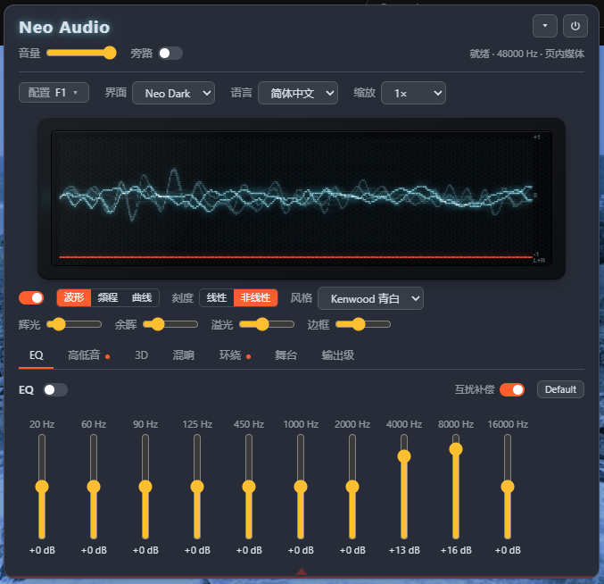
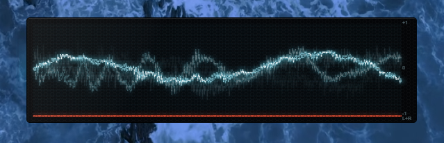
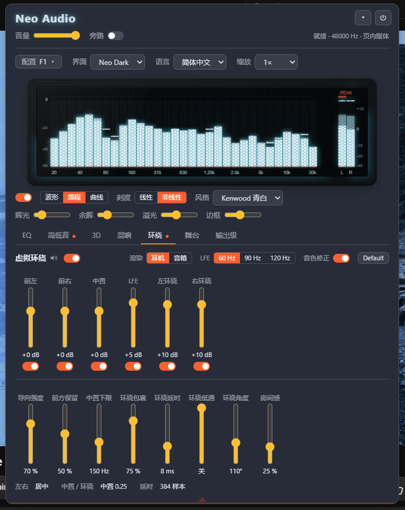
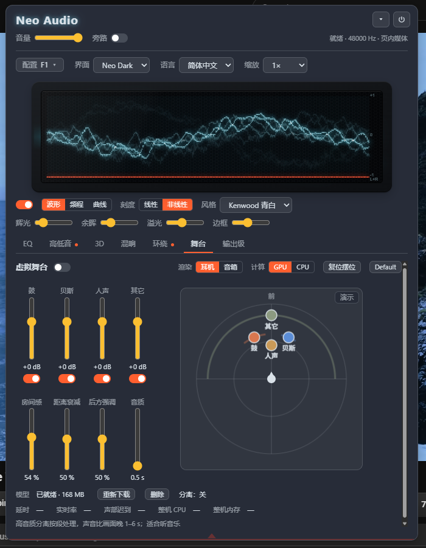

# Neo Audio — 浏览器音频处理插件 / Browser audio-processing extension

当前版本 / Current version: **0.1.0**

Neo Audio 把浏览器里播放的声音（网页媒体、本地文件）接进一条 DSP 链：10 段 EQ、低频 / 高频提升、混响、3D 立体声宽度、
虚拟环绕（5.1 上混 + HRTF），以及基于神经网络声部分离的"虚拟舞台"——把鼓、贝斯、人声、其它四个声部当成可以在舞台上拖动的
声音元素。面板上还有一块可以切波形 / 频谱 / 曲线的复古显示屏。源码仓库是私有的；这里只放打包好的插件，任何人可下载。

Neo Audio routes the sound a browser tab plays (web media or local files) through a DSP chain: 10-band EQ, bass / treble
enhancement, reverb, 3D stereo width, virtual surround (5.1 upmix + HRTF) and a neural-separation "virtual stage" that turns
drums, bass, vocals and the rest into sound elements you can drag around the listener. The panel also has a retro display
(waveform / spectrum / curve). The source repository is private; this repository only holds the packaged extensions.

## 下载 / Download

| 浏览器 / Browser | 下载 / Download | 安装说明 / Install |
|---|---|---|
| Chrome（及 Chromium 系 / and Chromium-based） | [chrome/neo-audio-chrome.zip](chrome/neo-audio-chrome.zip) | [chrome/README.md](chrome/README.md) |
| Firefox | [firefox/neo-audio-firefox.zip](firefox/neo-audio-firefox.zip) | [firefox/README.md](firefox/README.md) |

每个目录里始终是最新一版；按版本打包的下载在 [Releases](../../releases)。
Each directory always holds the latest build; per-version downloads are under Releases.

"虚拟舞台"第一次使用时会从 [Neo-Audio-models](https://github.com/infohex/Neo-Audio-models) 下载一次分离模型（168 MB），之后留在浏览器里。
The "virtual stage" downloads its separation model (168 MB) once from Neo-Audio-models on first use and keeps it in the browser.

## 怎么用 / How to use

在有声音的页面上点工具栏的 Neo Audio 图标激活插件，页面底部会出现这个圆钮：

Click the Neo Audio toolbar icon on a page with sound to activate the extension; this round button appears at the bottom of the page:

圆钮会随着音量轻轻跳动；**点一下它就唤出面板**，再点一下收起。圆钮和面板都可以拖到你喜欢的位置，位置会记住。

The button pulses with the level; **click it to open the panel**, click again to fold it away. Both the button and the panel can be dragged anywhere, and the positions are remembered.

## 界面 / Screenshots

**EQ 与显示屏 / EQ and the display** — 10 段 EQ 带互扰补偿；显示屏这里是波形视图，Kenwood 青白风格。
10-band EQ with interaction compensation; the display is in waveform view, "Kenwood" cyan style.

**显示屏单独弹出 / The display on its own** — 双击显示屏，它会脱离面板浮在页面上（面板收起），可以拖动、右键改大小和透明度，再双击回到面板。
Double-click the display and it floats on the page by itself (the panel folds away); drag it, right-click for size and opacity, double-click again to put it back.

**虚拟环绕 / Virtual surround** — 5.1 上混后六路独立增益与静音，耳机（HRTF）或音箱渲染，LFE 分频、导向强度、环绕延时等；显示屏切到频谱视图。
Six channel gains and mutes after the 5.1 upmix, headphone (HRTF) or speaker rendering, LFE crossover, steering, surround delay; the display in spectrum view.

**虚拟舞台 / Virtual stage** — 神经网络把音乐分成鼓、贝斯、人声、其它四个声部，每个声部是舞台上可拖动的元素（方位、距离），"演示"键让人声绕听者转一圈；
音质推杆在延时和分离质量之间取舍，GPU（WebGPU）或 CPU 计算。
The network separates the music into drums, bass, vocals and the rest; each is an element you drag on the stage (azimuth, distance), the Demo button sends the vocals around the listener; the quality fader trades latency for separation quality, computed on the GPU (WebGPU) or CPU.

